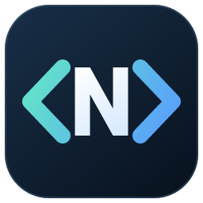
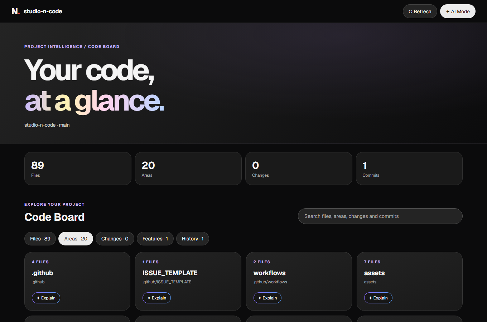
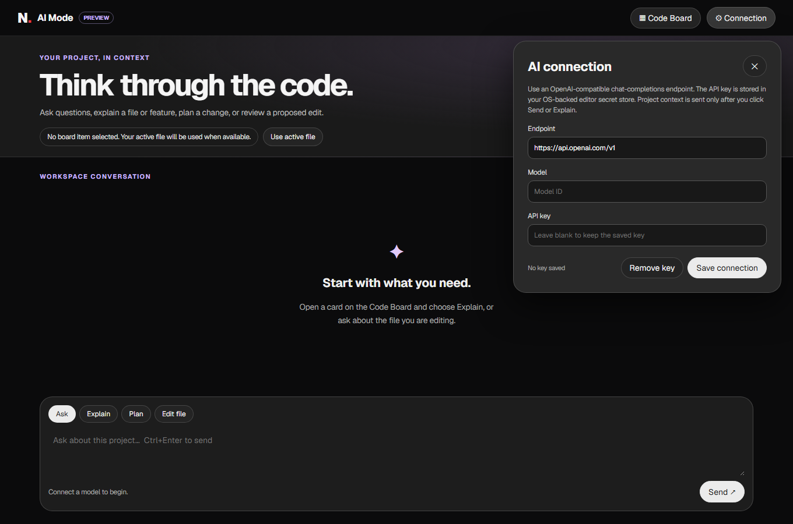

<p align="center"></p>

# studio-n-code

A desktop coding studio by Studio N, with a focused workspace, integrated Git tools and practical keyboard commands.

**Windows x64 preview:** [Download a release](https://github.com/nilsenj/studio-n-code/releases) and run the `windows-x64-setup.exe` asset. No developer tools are required to install the app. See [INSTALL.md](INSTALL.md) for portable installation, updates and troubleshooting. Preview binaries are currently unsigned.

## Features

- Studio N identity: Geist typography, charcoal surfaces, pill controls and pastel accents.
- Project, branch and run controls, tool-window rails and integrated terminal/debugger.
- Search across files, workspace symbols and actions; 61 mapped commands.
- Git-backed Code Board for files, areas, changes, features and history. Every card opens detailed Git/file metadata and includes AI Explain.
- AI Mode for OpenAI, Google Gemini and Anthropic, with automatic model discovery, a balanced recommendation, separate OS-stored API keys, questions, plans and diff-reviewed single-file edits.
- Visible command feedback, including missing providers, errors and cancellation.
- Git commit checklist, branches, history graph, commit details and diffs.
- Open VSX extension search/install and compatible VSIX files.
- Pinned Code OSS engine and reproducible build customizations.

## Preview

| Code Board | AI Mode |
| --- | --- |
|  |  |

## Keyboard workflow

| Action | Shortcut |
| --- | --- |
| Search Everywhere | Double Shift |
| Find Action | Ctrl+Shift+A |
| Reformat / Auto-Indent | Ctrl+Alt+L / Ctrl+Alt+I |
| Commit / Git Log | Ctrl+K / Alt+9 |
| Terminal | Alt+F12 |
| Run / Debug | Shift+F10 / Shift+F9 |
| Settings | Ctrl+Alt+S |

Formatting and refactoring depend on language providers. PHP syntax/basic tooling is included; advanced intelligence, framework support and Xdebug require compatible extensions. Extension/service licenses can limit compatibility.

## Documentation

- [Install, update and uninstall](INSTALL.md)
- [Usage](docs/usage.md) and [all shortcuts](docs/shortcuts.md)
- [Extension installation and compatibility](docs/extensions.md)
- [Code Board and AI Mode](docs/ai-board.md)
- [Studio N design system](DESIGN.md)
- [Build from source](BUILDING.md)
- [Architecture](docs/architecture.md) and [verification](docs/verification.md)
- [Contributing](CONTRIBUTING.md), [security](SECURITY.md) and [changelog](CHANGELOG.md)

## Source build

Follow [BUILDING.md](BUILDING.md) for C++/SDK, Python and Node prerequisites, then:

```powershell
git clone https://github.com/nilsenj/studio-n-code.git
cd studio-n-code
npm ci
npm run build
npm start
```

The release target is Windows x64. Signing, automatic updates and other platform packages are not available yet.

## License

Application-specific source and documentation use [MIT](LICENSE). The editor engine, fonts, agency identity, runtime and extensions retain their attribution and licenses: [NOTICE.md](NOTICE.md).
